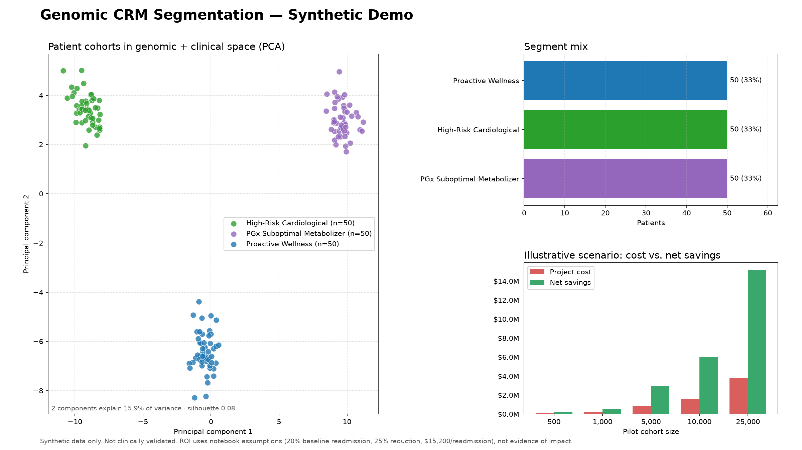

# Genomic CRM Segmentation Demo

A small, reproducible Python project built from `Untitled0.ipynb`. It turns the
notebook's synthetic genomic/clinical cohort, PCA visualization, patient
profiling, CRM mapping, CSV export, and ROI scenario into a testable pipeline
and local dashboard.

> **Synthetic demo only.** The generated cohort is artificial. This project is
> not a medical device, does not diagnose or recommend treatment, and has not
> been clinically validated. Do not upload real patient records or use its
> segment labels for care decisions. CRM output is a demonstration CSV; there
> is no live EHR or CRM connection.

## Presentation chart



The one-slide summary shows the PCA cohort map, segment mix, and the
illustrative cost-versus-net-savings scenario. Regenerate it (optionally from
your own synthetic CSV) with:

```powershell
genomic-segmentation chart --output docs/images/segmentation-summary.png
```

The silhouette score is computed in the full scaled feature space, so it can be
low even when the 2-D PCA view shows clearly separated clusters.

## Key insights

Results below come from the default synthetic demo (150 patients, 500 gene
features, seed 42, 3 clusters). They describe how the method behaves on planted
data, not on real patients.

| Segment (rule-derived) | Patients | Cardio PRS | Diabetes PRS | Mean BMI | PGx concern rate | Campaign |
| :--- | :---: | :---: | :---: | :---: | :---: | :--- |
| High-Risk Cardiological | 50 | 0.86 | 0.79 | 31.1 | 20% | `CAMP-CARDIO-2026` |
| PGx Suboptimal Metabolizer | 50 | 0.25 | 0.29 | 25.5 | 100% | `CAMP-PGX-ALERT` |
| Proactive Wellness | 50 | 0.26 | 0.23 | 26.2 | 18% | `CAMP-LONGEVITY` |

- **The method recovers planted structure.** K-means assigned all 150 patients
  to the cohort they were generated from (adjusted Rand index 1.0 across seeds
  1, 7, and 42). This is expected for synthetic data with injected signal. It
  shows the pipeline works, not that real genomic data will separate this
  cleanly.
- **Segments are distinguishable on clinical profile as well as genes.** The
  cardiological cluster stands out on both polygenic risk scores and BMI. The
  PGx cluster is defined by its metabolizer status (100% intermediate or poor).
  The wellness cluster is the low-risk baseline.
- **Each cluster has its own gene signature.** The top differentiating genes
  fall in the injected blocks (for example `gene_034` and `gene_008` for the
  cardiological cluster, `gene_075` and `gene_079` for the PGx cluster).
- **A low silhouette score does not mean poor clusters here.** The silhouette
  is 0.08 even though the PCA map shows three clear groups. With 500 noisy gene
  dimensions in the distance calculation, within-cluster noise dominates. The
  two PCA components show only 15.9% of total variance. Silhouette also peaks
  at k=2 (0.093) rather than k=3 (0.082), so it should not be the sole guide to
  choosing the number of clusters.
- **Engagement barely differs between segments.** Portal logins (3.7 to 4.1 per
  month) and wellness participation (30% to 44%) are close across clusters, so
  engagement is not what separates these segments.

## Takeaways

- Combining genomic and clinical features can produce interpretable cohorts
  that map directly to a small set of CRM actions.
- The pipeline is reproducible end to end: validate, scale, cluster, profile,
  and export a pseudonymous roster. The CRM export contains no biomarkers.
- Segment names come from threshold rules on cluster averages. They are labels
  for communication, not diagnoses.
- The notebook's segment counts (7, 4, and 2 patients) came from random
  assignment of 13 example patients, not from clustering. Only this project's
  pipeline derives segments from data.

## ROI scenario: what it does and does not show

At the notebook's assumptions (20% baseline readmission, 25% relative
reduction, $15,200 per readmission, $75,000 fixed plus $150 per patient):

| Cohort | Gross savings | Project cost | Net scenario |
| ---: | ---: | ---: | ---: |
| 500 | $380,000 | $150,000 | $230,000 |
| 1,000 | $760,000 | $225,000 | $535,000 |
| 5,000 | $3,800,000 | $825,000 | $2,975,000 |
| 25,000 | $19,000,000 | $3,825,000 | $15,175,000 |

- Break-even is about 123 patients under these assumptions.
- Savings scale **linearly** with cohort size. Only the ratio of savings to cost
  improves, and it levels off near 5x as the fixed cost is spread out. The
  notebook's description of "non-linear" savings is not supported by its own
  formula.
- The model applies the 25% reduction to every patient in the cohort. In
  practice only patients with a relevant risk (for example PGx flags) could
  benefit, so the real addressable group is likely much smaller.
- Every input is an assumption. None is measured by this project.

## Recommendations

1. **Validate on real, approved data before drawing conclusions.** Run under
   the proper privacy, consent, and governance controls, and keep real patient
   data out of this demo tooling.
2. **Choose the number of clusters deliberately.** Compare several values of k
   with stability checks across seeds, and review clusters with clinicians
   instead of relying on one metric.
3. **Reduce dimensions before clustering real genomic data.** Selecting
   informative features or clustering on PCA components would raise cluster
   separation scores and reduce noise.
4. **Use pharmacogenomic rules from established clinical guidance.** Do not
   infer PGx status from unsupervised clusters. Keep medication decisions with
   qualified clinicians and pharmacists.
5. **Replace ROI assumptions with local measurements.** Use observed
   readmission rates, intervention costs, and the share of patients each
   campaign can actually reach. Test impact in a controlled pilot with a
   comparison group before claiming savings.
6. **Check fairness before use.** Compare segment assignment and campaign
   outreach across demographic groups, and confirm consent for each
   outreach channel.
7. **Integrate with a CRM only through an approved path.** The current output
   is a CSV. A live connection needs security review, audit logging, and
   access controls.

## Run locally

From this folder in PowerShell:

```powershell
py -m venv .venv
.\.venv\Scripts\Activate.ps1
python -m pip install --upgrade pip
python -m pip install -e ".[dev]"
streamlit run dashboard.py
```

The dashboard starts with deterministic synthetic data. You can also upload a
synthetic CSV with the schema below, choose a cluster count, inspect the PCA
map and cluster profiles, download a pseudonymous CRM roster, and adjust the
illustrative financial scenario.

## Command line

Generate a synthetic cohort:

```powershell
genomic-segmentation demo --output outputs/demo_patients.csv --patients 150 --genes 500
```

Cluster a CSV and export CRM campaign assignments:

```powershell
genomic-segmentation segment --input outputs/demo_patients.csv --output outputs/crm_roster.csv --clusters 3
```

The CRM export contains only `patient_id`, `cluster_id`, `segment_name`,
`next_best_action`, and `campaign_id`. It does not export genomic features,
clinical features, names, or the synthetic cohort label.

## Input CSV contract

Supply one row per pseudonymous patient. Required columns:

- `patient_id`: unique, non-empty pseudonymous identifier (not a name, email,
  medical record number, or other direct identifier).
- `age`, `bmi`, `cardiovascular_prs`, `diabetes_prs`,
  `portal_logins_30d`, `wellness_participation`: numeric clinical/engagement
  fields. Precomputed PRS fields are expected to be on a comparable 0–1 scale
  for the demo's profile labels.
- `pgx_status`: categorical value such as `normal`, `intermediate`, or `poor`.
- At least two numeric `gene_*` expression fields.

Numeric missing values are median-imputed; missing PGx categories are marked
`unknown`. If present, `demo_cohort` is ignored for clustering and excluded
from the CRM export. It exists only in generated data for demo validation.
Other fields are not used by the model.

## Method

1. Validate the input schema and pseudonymous IDs.
2. Impute and scale numeric genomic, clinical, and engagement features; encode
   PGx status.
3. Fit K-means to the complete scaled feature space and PCA to display the
   first two dimensions.
4. Summarize each cluster using clinical/engagement averages and the top five
   differentiating synthetic gene features.
5. Translate cohort profiles into the three notebook CRM campaigns.

The segment names are descriptive rules over unsupervised cluster profiles,
not diagnoses or individualized medical assessments. PCA is a visualization,
and the silhouette score is a mathematical separation metric, not a clinical
quality measure.

## Illustrative ROI assumptions

The calculator defaults reproduce the notebook's scenario: 20% baseline
readmission rate, 25% relative reduction, $15,200 per readmission, $75,000
fixed setup cost, and $150 variable cost per patient. At 1,000 patients this
produces $760,000 gross scenario savings, $225,000 project cost, and $535,000
net scenario savings. These are assumptions—not validated estimates, study
results, or guarantees of financial/clinical impact.

## Tests

```powershell
python -m pytest
```
